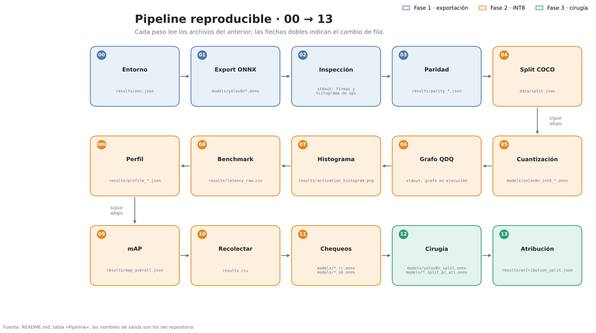
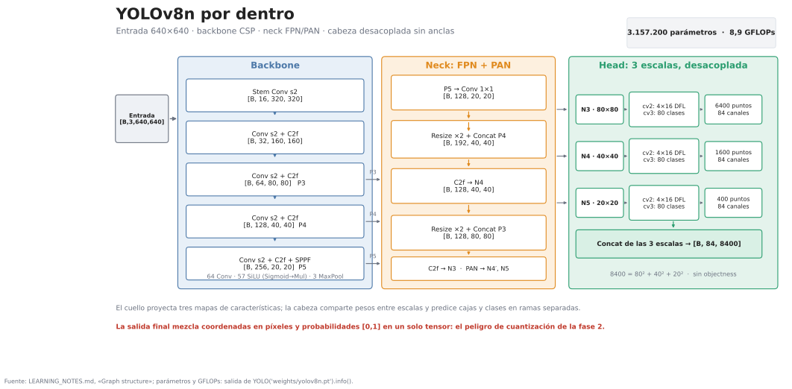
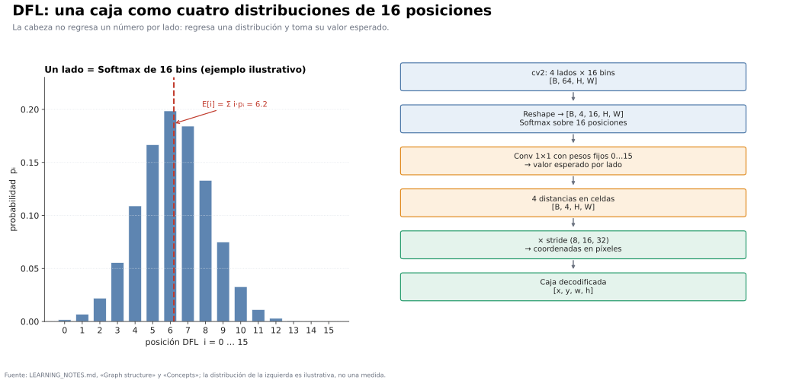
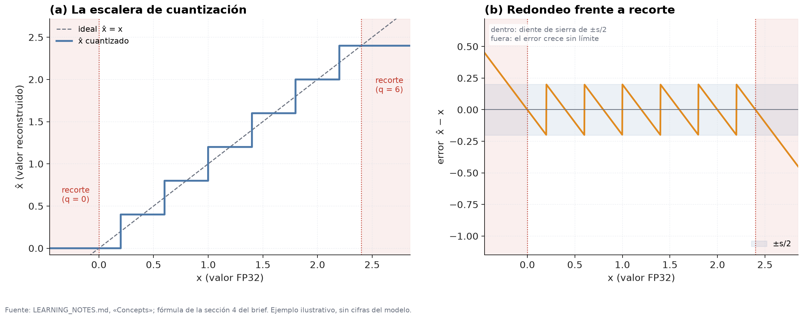
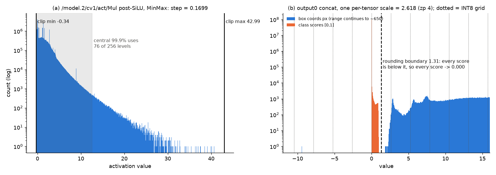
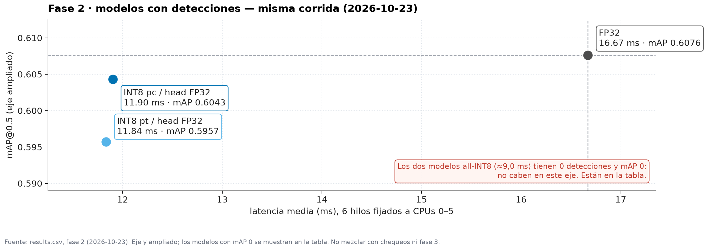
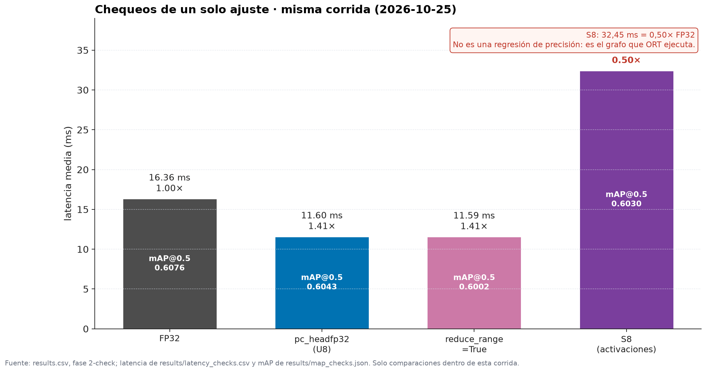
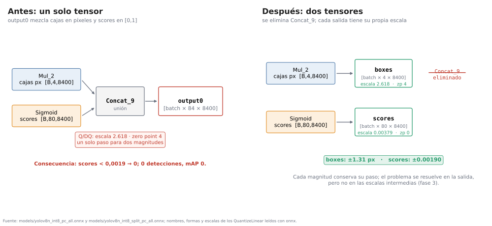
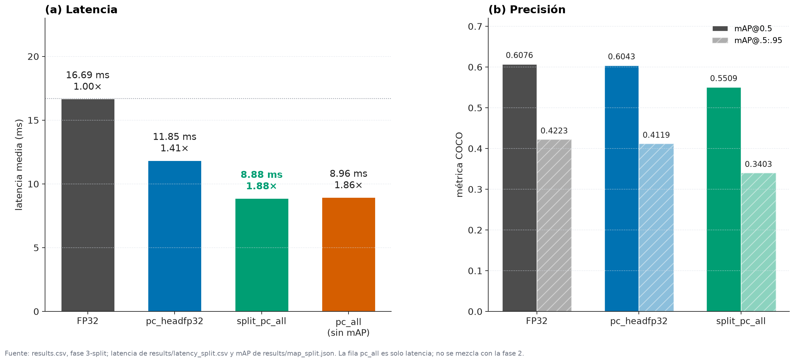
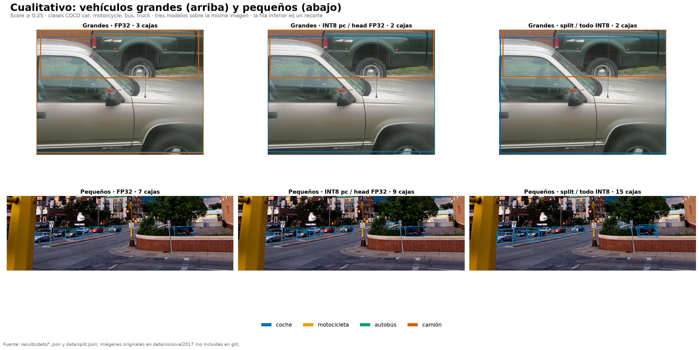

<!-- _class: lead -->

# YOLOv8n en CPU: exportar a ONNX y cuantizar a INT8

**Qué velocidad se gana y qué precisión se paga — mirando el grafo que ONNX Runtime (ORT) ejecuta de verdad**

Ricardo · 28 de octubre de 2026

ONNX (Open Neural Network Exchange), formato abierto de grafo · ORT (ONNX Runtime), motor que lo ejecuta · INT8 (entero de 8 bits) · YOLOv8n (variante nano de YOLO, You Only Look Once) · CPU (unidad central de proceso)

<!--
Sin cifras medidas en esta diapositiva. Fuente del marco: README.md, BRIEF.md y el repositorio LPRA.
La tesis que sostiene la charla: los problemas serios aparecieron al inspeccionar el grafo que ONNX Runtime ejecuta, no el archivo .onnx ni el código de entrenamiento.
-->

---

# El problema: detectar vehículos rápido, en CPU

**ALPR** (*Automatic License Plate Recognition*, reconocimiento automático de placas) necesita una etapa previa: detectar coches, motos, autobuses y camiones.

La pregunta del proyecto: **¿cuánta velocidad da INT8 y cuánta precisión cuesta** en CPU, sin GPU (*Graphics Processing Unit*, unidad de procesamiento gráfico)?

Fuera de alcance reentrenamiento · GPU · lectura de placas · video en tiempo real

150

imágenes de calibración

646

imágenes de evaluación

4

clases COCO (<em>Common Objects in Context</em>): car, motorcycle, bus, truck

1 CPU

Ryzen 9 7900X3D · 6 hilos fijados a CPUs 0–5

COCO val2017 es un <em>proxy</em>: no son imágenes reales de ALPR. La etapa evaluada es la detección de vehículos, no la lectura de matrículas.

<!--
Fuentes: data/split.json (seed 0; 150 calibración, 646 evaluación); 04_split.py (clases 3, 4, 6 y 8 de COCO); README.md, «Headline results» (Ryzen 9 7900X3D, CPU EP, 6 intra-op threads fijados a CPUs 0–5).
No se usa ninguna latencia en esta diapositiva. La palabra GPU se define aquí para que no aparezca sin glosa.
-->

---

# Glosario mínimo

| Término | Significado | En este proyecto |
|---|---|---|
| **ONNX** | *Open Neural Network Exchange*: formato abierto que describe un modelo como grafo de operadores | El archivo `.onnx` exportado |
| **ORT** | ONNX Runtime: motor que ejecuta grafos ONNX | Versión 1.31, CPU EP |
| **EP** | *Execution Provider*: backend de hardware que usa ORT | `CPUExecutionProvider` |
| **Opset** | versión del conjunto de operadores ONNX que el archivo puede usar | 17 |
| **FP32** | punto flotante de 32 bits | modelo de referencia |
| **INT8 / U8 / S8** | entero de 8 bits; U8 sin signo (0–255), S8 con signo (−128–127) | activaciones U8, pesos S8 |
| **PTQ** | *Post-Training Quantization*: cuantizar un modelo ya entrenado, sin reentrenar | método usado |
| **QDQ** | formato que anota el grafo FP32 con pares Q→DQ | formato usado |
| **Q / DQ** | nodos `QuantizeLinear` / `DequantizeLinear` | marcan tensores INT8 |
| ***Scale*, *zero point*** | parámetros de la cuantización afín: q = round(x/s) + z, x̂ = s(q−z) | calculados por calibración |
| ***Per-tensor* / *per-channel*** | una escala por tensor / una escala por canal de salida de los pesos | diseño 2×2 de la fase 2 |
| **BN** | *Batch Normalization*: normalización por lotes; en inferencia se pliega en la convolución | explica por qué hace falta *per-channel* |
| **SiLU** | *Sigmoid Linear Unit*: x·σ(x), activación de YOLOv8 | en ONNX: `Sigmoid` → `Mul` |
| **C2f** | bloque de YOLOv8 derivado de CSP (*Cross Stage Partial*): dos convoluciones y concatenación de ramas | backbone y neck |
| **SPPF** | *Spatial Pyramid Pooling – Fast*: tres `MaxPool` en serie | 3 nodos `MaxPool` |
| **FPN / PAN** | *Feature Pyramid Network* / *Path Aggregation Network*: combinan mapas de varias escalas | el neck; 2 `Resize` |
| **DFL** | *Distribution Focal Loss*: cada lado de la caja se predice como distribución sobre 16 posiciones | 16 bins por lado |
| **Stride** | píxeles de imagen que representa una celda del mapa | 8, 16 y 32 |
| **NMS** | *Non-Maximum Suppression*: eliminar cajas repetidas | fuera del grafo, en Python |
| **IoU / AP / mAP** | intersección sobre unión / *Average Precision* por clase / su media | mAP@0.5 y mAP@.5:.95 |
| **mAP@0.5** | mAP con IoU ≥ 0,5 | métrica principal |
| **mAP@.5:.95** | mAP promediado en IoU 0,50–0,95 en pasos de 0,05; exige cajas más precisas | métrica de localización |

Glosario completo en el apéndice. Cada término se vuelve a definir en su primer uso dentro de la narrativa.

<!--
Definiciones tomadas de BRIEF.md, sección 4, revisadas contra el proyecto. Los términos no incluidos aquí (CNN, YOLO, ALPR, COCO, QAT, QOperator, VNNI y otros) se definen en su primera aparición o en el glosario completo del apéndice.
No hay cifras medidas en esta diapositiva; 17 es el opset de exportación y 8/16/32 son los strides de YOLOv8n, documentados en LEARNING_NOTES.md, «Graph structure».
-->

---

# Método en una imagen: 15 scripts, un solo contrato

Cada fase escribe archivos que la siguiente lee; <code>10_collect_results.py</code> reconstruye <code>results.csv</code> desde los resultados crudos. Las flechas dobles son cambios de fila, no pasos adicionales.

<!--
Fuente: README.md, tabla «Pipeline» (script, propósito y salida principal). La secuencia va de 00_env_check.py a 13_attribute_split.py; 08b_profile.py es el perfilado opcional.
La figura se genera con presentation/figs/make_pipeline.py a partir de esa tabla. No se usan cifras de latencia ni de precisión.
-->

---

# YOLOv8n a vista de pájaro

YOLOv8n es una CNN (<em>Convolutional Neural Network</em>, red neuronal convolucional). Backbone = extractor; neck = mezcla de escalas; head = predicción. Entrada <code>[B, 3, 640, 640]</code>, con <code>B</code> = <em>batch</em> (tamaño del lote); GFLOPs = miles de millones de operaciones de coma flotante.

<!--
Fuente de la arquitectura: LEARNING_NOTES.md, «Graph structure» (64 Conv, 57 SiLU, 3 MaxPool, 2 Resize, cabeza /model.22/, salida 8400).
Fuente de parámetros y GFLOPs: salida local de `python -c "from ultralytics import YOLO; YOLO('weights/yolov8n.pt').info()"`: 129 layers, 3,157,200 parameters, 8.9 GFLOPs. Es la regla 7 del BRIEF: dato obtenido ejecutando código, no de memoria.
La figura se genera con presentation/figs/make_arch.py.
-->

---

# Bloques básicos: Conv, C2f, SPPF

<h3>Conv (convolución) + BN + SiLU</h3>

<code>y = SiLU(BN(Conv(x)))</code>

La BN (<em>Batch Normalization</em>) es un mapa afín por canal; al inferir se pliega dentro de los pesos de la convolución. SiLU = <code>x·σ(x)</code>.

<h3>C2f</h3>

Bloque de YOLOv8 derivado de CSP (<em>Cross Stage Partial</em>): parte los canales en dos ramas, aplica convoluciones y concatena. El backbone y el neck lo usan.

<h3>SPPF</h3>

<em>Spatial Pyramid Pooling – Fast</em>: tres <code>MaxPool</code> (agrupación máxima) en serie para ampliar el campo receptivo sin bajar más la resolución.

<h3>Lo que ve ONNX</h3>
<pre>Sigmoid → Mul      ×57   # SiLU
Sigmoid            ×1    # clases
MaxPool             ×3   # SPPF
Resize              ×2   # FPN/PAN
Conv               ×64</pre>

El grafo no tiene un operador «SiLU»: cada activación se expande a <code>Sigmoid</code> → <code>Mul</code>. Los <strong>58 Sigmoid</strong> son 57 SiLU más la sigmoide final de las clases.

64 Conv · 57 SiLU · 3 MaxPool · 2 Resize

Conteo del grafo legacy con batch dinámico.

<!--
Fuente: LEARNING_NOTES.md, «Graph structure (yolov8n, legacy, 407 nodes)»: 64 Conv (BN folded), 57 SiLU expandidas como Sigmoid→Mul (+1 Sigmoid para clases = 58), 3 MaxPool (SPPF), 2 Resize (FPN).
Las definiciones de CSP, C2f, SPPF y SiLU son las del glosario del BRIEF, sección 4. No hay latencias en esta diapositiva.
-->

---

# La cabeza y las 8400 predicciones

80×80

<strong>6400 puntos</strong> <em>stride</em> 8: objetos pequeños

40×40

<strong>1600 puntos</strong> <em>stride</em> 16: objetos medianos

20×20

<strong>400 puntos</strong> <em>stride</em> 32: objetos grandes

6400 + 1600 + 400 = 8400

**Cada punto predice 84 números:** 4 coordenadas de caja + 80 probabilidades de clase.

La rama <code>cv2</code> produce **4 lados × 16 bins** para la **DFL** (*Distribution Focal Loss*: la caja como distribución). La rama <code>cv3</code> produce las **80 clases**.

**No hay *objectness*** (puntuación de «hay objeto») ni **anclas** (*anchors*, cajas de referencia): YOLOv8 es *anchor-free*.

El **stride** son los píxeles de imagen que representa una celda del mapa: 8, 16 y 32.

<!--
Fuente: LEARNING_NOTES.md, «Graph structure» y «Concepts». La suma 80² + 40² + 20² = 6400 + 1600 + 400 = 8400; cada punto tiene 84 canales (4 cajas + 80 clases). No hay objectness en YOLOv8; NMS va fuera del grafo.
La figura de arquitectura de la diapositiva 5 muestra las tres escalas y la cabeza desacoplada. No hay cifras de latencia/precisión.
-->

---

# DFL: la caja como distribución

Cada lado de la caja se predice con 16 bins; <strong>Softmax</strong> los convierte en probabilidades y una <strong>Conv 1×1</strong> con pesos fijos 0…15 toma el valor esperado. Después, la distancia se multiplica por el <em>stride</em> para pasar a píxeles.

<!--
Fuente: LEARNING_NOTES.md, «Graph structure»: DFL = Reshape → Transpose → Softmax(16 bins) → Conv 1×1 con pesos fijos 0…15 (valor esperado) → decodificación de anclas (Sub/Add/Div/Mul por stride).
La distribución de la izquierda es ilustrativa, no una medida del modelo; la figura lo indica. La figura se genera con presentation/figs/make_dfl.py.
-->

---

# output0: dos magnitudes en un tensor

output0 &nbsp; [B, 84, 8400]

<h3>4 cajas</h3>

<code>x, y, w, h</code> en píxeles; rango aproximado −10…657.

<h3>80 scores de clase</h3>

Probabilidades en [0, 1]; una por clase COCO.

**El problema no es la cuantización en sí: es la mezcla.** Un solo *scale* *per-tensor* (una escala para todo el tensor) tiene que cubrir cajas de −10 a 657 px y scores de 0 a 1.

La **NMS** (*Non-Maximum Suppression*) no está en el grafo: se ejecuta en Python después de la inferencia.

Semilla de la fase 2

<strong class="red">La salida que hay que vigilar:</strong> si un solo paso de cuantización se fija con las cajas, los scores pequeños redondean a cero.

<!--
Fuente: LEARNING_NOTES.md, «Graph structure»: el último nodo es Concat_9(Mul_2 [boxes en px], Sigmoid [class probs]) → output0; NMS no está en el grafo.
Fuente del peligro: LEARNING_NOTES.md, «The output-concat hazard»: un scale per-tensor de 2.618 y zero point 4 redondea todos los scores a 0. Los valores exactos se miden en la fase 2 (diapositiva 17); el rango de cajas −10.47…657.17 sale de results/activation_hist_stats.json (diapositiva 17).
La barra es un esquema, no está a escala (4/84 se exagera para que se lea).
-->

---

# Qué es exportar: una pasada, un grafo

**Tracing** = ejecutar una pasada con un tensor real y registrar cada operador **ATen** (la biblioteca de operadores tensoriales de PyTorch) que se ejecuta. El exportador lo traduce a un operador ONNX de un **opset** fijo.

Los pesos pasan a **initializers** (tensores constantes del grafo). El control de flujo de Python se congela en el camino que tomó el *dummy*.

<pre># 01_export.py, idea
model.fuse()                 # BN → pesos Conv
model(dummy)                 # cachea anchors
torch.onnx.export(
    model, dummy, path,
    dynamo=False,            # legacy
    opset_version=17,
    dynamic_axes={"images": {0: "batch"}},
)</pre>

**Legacy vs dynamo:** desde torch 2.9 el default es `dynamo=True` (torch.export → onnxscript); el camino legacy es el que sigue la mayoría del código de despliegue y el que usamos aquí.

<strong>Opset 17</strong> (versión del conjunto de operadores ONNX) es lo que permite expresar QDQ <em>per-channel</em> en la fase 2: el eje de cuantización necesita un opset ≥ 13.

<!--
Fuente: LEARNING_NOTES.md, «What export is» y «Decisions in 01_export.py». El default dynamo=True desde torch 2.9 está documentado en la misma sección. El opset 17 se eligió para QDQ per-channel; la nota dice que per-channel QDQ necesita axis y opset ≥ 13.
La diapositiva no usa latencias ni mAP; solo explica el mecanismo de exportación. La evidencia numérica de la exportación está en la diapositiva 11.
-->

---

# Decisiones de exportación

<b>Pregunta</b>¿Qué hay que fijar antes de exportar?

<b>Hipótesis / razón</b>Fusionar BN, permitir lote variable y usar un opset que soporte QDQ <em>per-channel</em>.

<b>Decisión</b><code>fuse()</code> → forward <em>dummy</em> → legacy con <code>dynamic_axes</code>, opset 17.

<b>Evidencia</b>363 nodos estáticos → 407 con lote dinámico (+44); salida <code>[batch, 84, 8400]</code>.

| Decisión | Por qué | Efecto medido en el grafo |
|---|---|---|
| `fuse()` antes de exportar | La BN en inferencia es un mapa afín por canal; plegarla hace que la cuantización vea los pesos que realmente se ejecutan | 64 Conv con BN ya plegada |
| `dynamic_axes` en `images` | El <em>deployment</em> puede recibir lotes de distinto tamaño | 363 → 407 nodos; los `Reshape` de la cabeza leen la forma en runtime (+44 de <em>shape plumbing</em>) |
| Opset 17 | Necesario para QDQ <em>per-channel</em>; el eje de cuantización no se puede expresar en opsets antiguos | Habilita el diseño de la fase 2 |
| Legacy (`dynamo=False`) | Es el camino que usa la mayoría del código de despliegue; el default de torch 2.9 es `dynamo=True` | Grafo trazado, con nombres estables para inspeccionar |

El coste de <code>dynamic_axes</code> no es retórico: +44 nodos, casi todos <code>Shape → Gather → Unsqueeze → Concat</code> para reconstruir dimensiones que antes eran constantes.

<!--
Fuente: LEARNING_NOTES.md, «What dynamic_axes changed (from 02_inspect_graph.py)»: I/O [1,3,640,640] → ['batch',3,640,640]; +44 nodos (363 → 407); los Reshape de la cabeza pasan de Constant a Shape/Gather/Unsqueeze/Concat; la salida legacy pierde dims y dynamo las conserva.
Fuente: LEARNING_NOTES.md, «Decisions in 01_export.py»: fuse() primero, forward dummy para cachear anchors, Detect.export=True, opset 17.
-->

---

# Paridad: el *baseline* que hace atribuible la pérdida

<b>Pregunta</b>¿El grafo exportado decide lo mismo que PyTorch?

<b>Hipótesis</b>Sí, con diferencias de redondeo; la decisión top-1 no cambia.

<b>Decisión</b>Comparar 50 imágenes de COCO val2017, ORT CPU vs PyTorch CPU, batch=N y loop batch-1.

<b>Evidencia</b>Cajas 8,9e-3 px; scores 5,3e-5; top-1 idéntico en 50/50; batch=N = loop.

8,9e-3 px

máx. |Δ| en cajas error relativo ≈ 3,8e-5

5,3e-5

máx. |Δ| en scores

50/50

top-1 idéntico la detección principal no cambia

**¿Por qué no es cero?** La suma en FP32 no es asociativa: ORT fusiona operadores y reordena reducciones; el error de ~1e-7 relativo por operación se acumula a lo largo de ~60 capas.

**¿Por qué importa?** Sin paridad no se puede atribuir ninguna pérdida posterior a la cuantización. Es el contrato que separa «exportar» de «cuantizar».

<!--
Fuente: results/parity_coco50.json: n_images 50; batch=N boxes max_abs 0.00885009765625 px; scores max_abs 5.2869319915771484e-05; top1_identical true; batch=1 loop idéntico; top1 idéntico.
Fuente de la explicación: LEARNING_NOTES.md, «Parity (03_parity.py...)»: error relativo 3.8e-5; FP32 no asociativo; ORT reordena reducciones; ~60 capas. La frase «batch=N = loop» está en el JSON y en las notas.
-->

---

# Cuantización afín: una fórmula, dos errores

<b>Pregunta</b>¿Cómo representar FP32 en 8 bits sin perder lo importante?

<b>Hipótesis / razón</b>El error tiene dos fuentes: redondeo dentro del rango y recorte fuera de él.

<b>Decisión</b>Cuantización afín con <em>scale</em> y <em>zero point</em>; calibración estática MinMax (mínimo y máximo observados).

<b>Evidencia</b>La escalera muestra el paso <em>s</em>; el error de redondeo está acotado por ±s/2.

q = clamp(round(x/s) + z, 0, 255) &nbsp;&nbsp;·&nbsp;&nbsp; x̂ = s·(q − z)

<strong>Scale</strong> = tamaño de un paso; <strong>zero point</strong> = valor entero que representa el 0 real. Ejemplo didáctico de 7 niveles; el proyecto usa 256.

<!--
Fuente: LEARNING_NOTES.md, «Concepts»: q = clamp(round(x/s)+z, 0, 255), x̂ = s(q−z); error = clipping (fuera del rango) + rounding (±s/2 dentro). La calibración MinMax se detalla en la diapositiva 14.
La figura es didáctica y lo indica; no usa cifras del modelo. Se genera con presentation/figs/make_quant_affine.py.
-->

---

# Calibración: 150 imágenes que no se usan para evaluar

<b>Pregunta</b>¿Con qué datos fijo los rangos de cada tensor?

<b>Hipótesis / razón</b>Con imágenes representativas del <em>deployment</em>, nunca con las de evaluación.

<b>Decisión</b>Split fijo con semilla 0: 150 calibración / 646 evaluación; mismo preprocesado.

<b>Evidencia</b>identificadores disjuntos en <code>data/split.json</code>; calibrar con evaluación sería fuga de datos.

150

imágenes de calibración

Fijan los mínimos y máximos por tensor con <strong>PTQ</strong> (<em>Post-Training Quantization</em>: sin reentrenar).

646

imágenes de evaluación

Se usan solo para medir mAP; nunca para calcular rangos.

<strong>Un solo contrato de preprocesado:</strong> <code>common.preprocess</code> hace <em>letterbox</em> (redimensiona manteniendo proporción), relleno gris 114, RGB (rojo, verde, azul) y división por 255. Lo usan paridad, calibración, latencia y mAP. Cambiarlo invalida todos los rangos y todas las medidas.

<!--
Fuente: README.md, «Reproducibility notes» y «Setup»: split fijo SEED=0, 150 calibración + 646 evaluación; common.preprocess (letterbox, 114 pad, RGB, /255) es el contrato; nunca calibrar con evaluación.
Fuente: LEARNING_NOTES.md, «Concepts»: PTQ estática; ORT expone cada tensor intermedio, corre las imágenes de calibración y registra min/max. No hay cifras de latencia ni mAP en esta diapositiva.
-->

---

# QDQ: el archivo no es lo que se ejecuta

<b>Pregunta</b>¿Qué kernels ejecuta realmente ORT?

<b>Hipótesis / razón</b>QDQ es una anotación; al cargar, ORT fusiona <code>DQ → Op → Q</code> en kernels enteros.

<b>Decisión</b>Inspeccionar el grafo optimizado (<code>optimized_model_filepath</code>), no solo el archivo.

<b>Evidencia</b>El grafo en ejecución tiene <code>QLinearConv</code>, <code>QLinearSigmoid</code>, …

<h3>En el archivo</h3>
<pre>Q → Conv → DQ
Q → Sigmoid → DQ
Q → Mul → DQ</pre>

Los pares <strong>Q</strong> (<code>QuantizeLinear</code>) y <strong>DQ</strong> (<code>DequantizeLinear</code>) marcan qué tensores son INT8. El formato se llama <strong>QDQ</strong>; el contraste es <strong>QOperator</strong>, que hornea operadores enteros explícitos en el archivo.

<h3>Al cargar en ORT</h3>
<pre>QLinearConv   ×64
QLinearSigmoid×58
QLinearMul    ×58
QLinearConcat ×17
DQ restantes  ×15</pre>

Con la cabeza FP32, el grafo tiene <strong>63</strong> <code>QLinearConv</code>: la Conv del DFL queda en FP32.

<strong>Misma estructura de archivo, distinto grafo en ejecución.</strong> Por eso el diagnóstico se hace sobre el grafo optimizado y el <em>profiler</em>, no sobre el <code>.onnx</code> de entrada.

<!--
Fuente: LEARNING_NOTES.md, «Where Q/DQ landed (06_inspect_qdq.py)»: runtime graph QLinearConv ×64, QLinearSigmoid ×58, QLinearMul ×58, QLinearConcat ×17, 15 leftover DQ; headfp32: 63 QLinearConv.
Fuente: LEARNING_NOTES.md, «Concepts»: QDQ es anotación; ORT fusiona DQ→Op→Q; QOperator es el formato alternativo.
-->

---

# Configuración: U8, *per-channel*, sin *reduce_range*

<b>Pregunta</b>¿U8 o S8? ¿Per-tensor o per-channel? ¿Reduce range?

<b>Hipótesis / razón</b>VNNI consume u8 × s8 y acumula en int32; la BN plegada deja canales con rangos muy distintos.

<b>Decisión</b>Activaciones U8, pesos S8, <em>per-channel</em> en pesos, <code>reduce_range=False</code>.

<b>Evidencia</b>Rangos por canal 0,075–1,23 (16,5×); el canal débil conserva ~7 de 127 niveles con <em>per-tensor</em>.

<h3>U8 × S8 = VNNI nativo</h3>

<strong>VNNI</strong> (<em>Vector Neural Network Instructions</em>) ejecuta <code>vpdpbusd</code>: multiplica u8 × s8 y acumula en int32. No hay saturación de int16, así que <code>reduce_range=False</code> no hace falta.

<h3>Pesos <em>per-channel</em></h3>

Una escala por canal de salida. Como la escala multiplica el resultado entero, se puede aplicar después de la suma. En una activación no: por eso las activaciones quedan <em>per-tensor</em>.

<h3>La BN plegada importa</h3>

Al plegar BN, los canales de <code>/model.2/cv1</code> abarcan máximos de 0,075 a 1,23 (16,5×). Una sola escala deja al canal débil solo ~7 de 127 niveles.

<h3>La alternativa que no usamos</h3>

<strong>QAT</strong> (<em>Quantization-Aware Training</em>) simula la cuantización durante el entrenamiento. No se usó: este proyecto es PTQ, sin reentrenar.

<!--
Fuente: LEARNING_NOTES.md, «Concepts»: U8 activaciones × S8 pesos = operandos nativos de vpdpbusd; VNNI acumula 4 productos en int32; reduce_range es un workaround de saturación int16 de AVX2 y no se necesita. Per-channel se aplica a pesos; la escala por canal de salida factoriza fuera de la suma.
Fuente: LEARNING_NOTES.md, «Concepts»: BN folding hace que /model.2/cv1 max|w| por canal abarque 0.075–1.23 (16.5×); per-tensor deja el canal más débil 7 de 127 niveles.
QAT se define aquí; no se usa en el proyecto.
-->

---

# El peligro de output0: todo score a cero

<b>Pregunta</b>¿Qué pasa si cuantizo todo el grafo con una sola escala?

<b>Hipótesis</b>La escala de las cajas (2,618) redondea todos los scores a cero.

<b>Decisión</b>Medir el histograma y calibrar con MinMax antes de evaluar.

<b>Evidencia</b>0 detecciones y mAP 0 en <code>pc_all</code> y <code>pt_all</code>.

2,618 · zero point 4

<em>scale</em> y <em>zero point</em> de <code>output0</code>

1,31 &gt; 1

la frontera de redondeo supera el score máximo posible

0 detecciones · mAP 0

todos los scores dequantizan a 0.000

La predicción se escribió antes de medir. Es el caso más claro de por qué hay que mirar el tensor, no solo el modelo.

<!--
Fuente: results/activation_hist_stats.json: output_concat_scale 2.6182219982147217, output_concat_zp 4; central 99.9% de /model.2/cv1 usa 76 de 256 niveles; el histograma muestra cajas −10…657 y scores [0,1].
Fuente: LEARNING_NOTES.md, «The output-concat hazard»: rounding boundary 1.31 > max score, todos los scores dequantizan a 0.000; medido *_all = 0 detecciones, mAP 0, predicho antes de medir.
Fuente del mapa: results/map_overall.json, filas yolov8n_int8_pc_all y pt_all con n_dets 0 y mAP50 0.
-->

---

# Diseño 2×2: *per-channel* y cabeza FP32

<b>Pregunta</b>¿Cuánto recupera <em>per-channel</em>? ¿Y dejar la cabeza en FP32?

<b>Hipótesis</b>Per-channel recupera la mayor parte; la cabeza FP32 evita el colapso de scores.

<b>Decisión</b>2×2: per-tensor (pt) / per-channel (pc) × todo cuantizado / cabeza FP32.

<b>Evidencia</b>Una sola corrida, 2026-10-23; tabla y dispersión.

| Modelo | ms | vs FP32 | mAP@0.5 | mAP@.5:.95 | detecciones |
|---|---:|---:|---:|---:|---:|
| FP32 | 16,67 | 1,00× | 0,6076 | 0,4223 | 148.828 |
| INT8 pt / head FP32 | 11,84 | 1,41× | 0,5957 | 0,4111 | 156.451 |
| **INT8 pc / head FP32** | **11,90** | **1,40×** | **0,6043** | **0,4119** | **153.420** |
| INT8 pt / todo | 9,02 | 1,85× | 0,0000 | 0,0000 | 0 |
| INT8 pc / todo | 9,05 | 1,84× | 0,0000 | 0,0000 | 0 |

<strong>pc_headfp32</strong>: −0,33 puntos de mAP@0.5 vs FP32; <strong>pt_headfp32</strong>: −1,19. Los dos modelos con todo el grafo en INT8 son los más rápidos y los únicos con 0 detecciones (no caben en el eje ampliado). <em>head FP32</em> = se excluyen de la cuantización los 34 nodos de decodificación de <code>/model.22/</code> fuera de <code>cv2</code>/<code>cv3</code>.

<!--
Fuente: results.csv, fase 2 (corrida 2026-10-23). Latencia de results/latency_raw.csv y mAP de results/map_overall.json. Filas exactas: FP32 16.6706 ms, 148828 dets; pc_headfp32 11.9012 ms, 0.6043129, 0.4118604, 153420; pt_headfp32 11.8356 ms, 0.5957246, 0.4110683, 156451; pt_all 9.0183 ms, 0; pc_all 9.048 ms, 0.
La tabla y la gráfica usan la misma corrida; no se mezclan con los chequeos del 2026-10-25 ni con la fase 3 del 2026-10-28.
La definición de head FP32 (34 nodos de /model.22/ fuera de cv2/cv3) está en README.md, «Why this shape».
-->

---

# Por qué 1,4× y no 3×: el costo está en los bordes

<b>Pregunta</b>¿Por qué el <em>end-to-end</em> no escala como el kernel de convolución?

<b>Hipótesis / razón</b>El kernel INT8 acelera, pero SiLU, Concat y un nodo FP32 diluyen la ganancia.

<b>Decisión</b>Perfilar por nodo con el <em>profiler</em> de ORT.

<b>Evidencia</b>Conv 3,0×; Softmax del DFL 3,25 ms FP32 vs 0,25 ms INT8.

3,0×

kernel Conv FP32 11,4 ms vs QLinearConv 3,8 ms

3,25 ms

un solo nodo FP32: <code>/model.22/dfl/Softmax</code> como QLinearSoftmax: 0,25 ms

2,5 vs 0,93 ms

SiLU INT8 (<code>QLinearSigmoid</code> + <code>QLinearMul</code>) vs <code>QuickGelu</code> FP32 fusionado

1,4 ms

<code>QLinearConcat</code>: re-cuantiza cada entrada a una escala común

<strong>El hallazgo:</strong> <code>pc_headfp32</code> es 2,9 ms más lento que el modelo todo-INT8 por <strong>un solo nodo FP32</strong>, el Softmax del DFL en un eje no contiguo. Excluir la cabeza no ahorra FLOPs (operaciones de coma flotante, ~0 %); cambia un kernel y su <em>layout</em>.

<!--
Fuente: LEARNING_NOTES.md, «Profiling explained a surprise (08b_profile.py...)»: FP32 Conv 11.4 ms vs QLinearConv 3.8 ms = 3.0×; SiLU INT8 QLinearSigmoid+QLinearMul 2.5 ms vs FP32 QuickGelu 0.93 ms; QLinearConcat 1.4 ms; /model.22/dfl/Softmax FP32 3.25 ms vs QLinearSoftmax 0.25 ms; headfp32 2.9 ms slower than all-INT8.
Los perfiles crudos están en results/profile_*.json (ignorados por git por tamaño). No se mezclan latencias de otras corridas: estos números son del perfilado de la fase 2 (2026-10-23).
-->

---

# reduce_range=True: sin beneficio de velocidad

<b>Pregunta</b>¿Ayuda reducir el rango de pesos en esta CPU?

<b>Hipótesis / razón</b>No: VNNI acumula en int32, no hay saturación de int16.

<b>Decisión</b>Mismo run, un solo ajuste: <code>pc_headfp32</code> con y sin <code>reduce_range</code>.

<b>Evidencia</b>11,59 vs 11,60 ms; las métricas de precisión no coinciden en signo.

| Variante (corrida 2026-10-25) | ms | vs FP32 | mAP@0.5 | mAP@.5:.95 |
|---|---:|---:|---:|---:|
| FP32 | 16,36 | 1,00× | 0,6076 | 0,4223 |
| `pc_headfp32` (U8, `reduce_range=False`) | 11,60 | 1,41× | 0,6043 | 0,4119 |
| `pc_headfp32` + `reduce_range=True` | 11,59 | 1,41× | 0,6002 | 0,4123 |

Hecho medido La latencia es idéntica (Δ 0,01 ms). El *reduce range* no compra velocidad en VNNI.

No establecido mAP@0.5 baja 0,41 puntos y mAP@.5:.95 sube 0,04; sin intervalos de confianza, el efecto en precisión no está establecido.

**Conclusión respaldada por los datos:** no hay beneficio de velocidad, así que no hay razón para pagar ni siquiera una posible pérdida de precisión. No se usa en el modelo recomendado.

<!--
Fuente: results.csv, fase 2-check y results/latency_checks.csv + results/map_checks.json (corrida 2026-10-25, con su propia fila FP32). Valores exactos: FP32 16.3564 ms; pc_headfp32 11.5996 ms, 0.6043129, 0.4118604; rr 11.5854 ms, 0.6001788, 0.4123407.
Fuente de la interpretación: LEARNING_NOTES.md, «Single-setting checks»: latencia idéntica; mAP@0.5 −0.41 pts y mAP@.5:.95 +0.04 pts; sin CI, el coste en precisión no está establecido.
No se compara esta latencia con la fase 2 ni con la fase 3; es una corrida distinta y así se indica.
-->

---

# S8: la predicción que falló

<b>Pregunta</b>¿Qué pasa si uso el tipo de activación por defecto de ORT, S8?

<b>Hipótesis (fallida)</b>«Igual o algo más lento que U8».

<b>Decisión</b>Medir la misma config con activaciones S8 y inspeccionar el grafo en ejecución.

<b>Evidencia</b>32,45 ms, 0,50× FP32; solo 6 de 64 convoluciones se fusionan.

Predicción fallida
<strong>32,45 ms = 0,50× FP32</strong> (casi 2× más lento), no «igual o algo más lento». El grafo S8 tiene <strong>202 Q + 418 DQ</strong>; <code>DequantizeLinear</code> solo consume 12,1 ms por ejecución. La precisión no es el problema (mAP@0.5 0,6030; mAP@.5:.95 0,4129): el problema es que el kernel no se fusiona.

Lección: la estructura del archivo no decide el rendimiento; el grafo que ORT ejecuta, sí. Mirar el <em>optimized model</em> y el <em>profiler</em> antes de razonar sobre instrucciones.

<!--
Fuente: results.csv, fase 2-check (2026-10-25): S8 32.4495 ms, speedup 0.5041, mAP50 0.6029605, mAP50_95 0.4128749; FP32 16.3564 ms.
Fuente: LEARNING_NOTES.md, «Single-setting checks»: predicción «equal or slightly slower»; solo 6 de 64 convs fusionan; 202 Q + 418 DQ; DequantizeLinear 12.1 ms/run; no QLinearSigmoid/QLinearMul en el grafo S8; hipótesis no verificada sobre la falta de kernels S8 para Sigmoid/Mul.
La figura checks.png usa solo esta corrida; las etiquetas mAP dentro de las barras no cambian el eje de latencia.
-->

---

# Fase 3: arreglar el grafo, no excluir nodos

<b>Pregunta</b>¿Se puede cuantizar todo el grafo sin el colapso de scores?

<b>Hipótesis / razón</b>Separar cajas y scores en dos salidas; cada una con su propia escala.

<b>Decisión</b>Borrar <code>Concat_9</code>; exponer <code>boxes</code> y <code>scores</code>; cuantizar todo.

<b>Evidencia</b>Paridad exacta: máx. |Δ| = 0; <code>boxes</code> scale 2,618; <code>scores</code> scale 0,00379.

La cirugía es exacta: al recomponer <code>concat(boxes, scores)</code> el resultado coincide con <code>output0</code> con diferencia 0 en FP32. La ventaja no es «excluir la cabeza»: es dar a cada magnitud su propio paso de cuantización.

<!--
Fuente: LEARNING_NOTES.md, «Phase 3 — Concepts»: se borra Concat_9, se renombran sus dos entradas a boxes/scores, se mueven sus value_info a graph.output; onnx.checker.check_model(full_check=True). Paridad exacta max|Δ|=0 (prueba con batch 2, ORT 1.29, no resultados COCO).
Fuente: models/yolov8n_int8_pc_all.onnx y models/yolov8n_int8_split_pc_all.onnx: output0 scale 2.618222, zp 4; boxes scale 2.618222, zp 4; scores scale 0.003791658, zp 0. La figura make_split_graph.py los lee con onnx.
La escala de boxes se predijo ~2.5 px y resultó 2.61822; el rango [−10.47, 657.17] y ±1.3091 px están en LEARNING_NOTES.md, «Results».
-->

---

# La división: 1,88× y 0,5509 mAP@0.5

<b>Pregunta</b>¿El modelo dividido es usable?

<b>Hipótesis / razón</b>Sí: misma latencia que <code>pc_all</code>, pero con scores no nulos.

<b>Decisión</b>Medir latencia y mAP en una sola corrida, la del 2026-10-28.

<b>Evidencia</b>8,88 ms, 1,88×; mAP@0.5 0,5509; 134.945 detecciones.

<strong class="green">Domina a <code>pc_all</code>:</strong> 8,88 vs 8,96 ms, y 134.945 detecciones en vez de 0.

<strong>No domina a <code>pc_headfp32</code>:</strong> 2,97 ms menos por inferencia (25 % menos tiempo), pero cuesta 5,34 puntos de mAP@0.5 y 7,16 de mAP@.5:.95.

<!--
Fuente: results.csv, fase 3-split (2026-10-28): FP32 16.688 ms, 0.6076, 0.4223, 148828; pc_headfp32 11.8523 ms, 1.408×, 0.6043, 0.4119, 153420; split_pc_all 8.8784 ms, 1.8796×, 0.5508906, 0.3402571, 134945; pc_all 8.9603 ms, 1.8624×, sin mAP en esta corrida (0 dets en fase 2).
La figura split.png usa solo esta corrida. «25 % menos tiempo» = (11,85 − 8,88) / 11,85 = 25,1 %; son 2,97 ms menos por inferencia. No es «25 % más rápido» en el sentido de velocidad (sería 1,33×), por eso se explicita el tiempo.
-->

---

# Predicción fallida: ±1,3 px no explica 5,3 puntos

<b>Pregunta</b>¿De dónde sale la pérdida de precisión del split?

<b>Hipótesis (fallida)</b>El paso de la salida, ±1,31 px, es la causa principal.

<b>Decisión</b>Leer todas las escalas Q del grafo, no solo la salida.

<b>Evidencia</b><code>Concat_8</code>: paso 0,314 celdas → 2,5 px en stride 8 y 10 px en stride 32.

| Tensor | Unidades | Paso INT8 | En píxeles |
|---|---|---:|---|
| `Concat_8` (xywh antes de ×stride) | celdas, 0–80 | 0,314 celdas | 2,5 px (stride 8) · 10 px (stride 32) |
| `Sub_1` (w, h) | celdas, 0–28 | 0,109 → 0,314 | hasta 10 px |
| `Concat_7` (logits de clase) | logits, −60–3,5 | 0,25 | — |
| `scores` (después de Sigmoid) | probabilidad | 0,0038 | scores &lt; 0,0019 → 0 |

**El paso de la salida no es el paso relevante.** `Concat_8` mezcla centros (0–80) y tamaños (0–28) en una sola escala, y la multiplicación por el *stride* amplifica el error: hasta ~10 px en stride 32.

**AP@0.5 (AP con IoU 0,5) vs FP32:** car −11,5; truck −5,7; motorcycle −4,1; bus −1,3. Small, medium y large son los rangos de área de COCO: small y medium absorben el daño; large casi no.

<!--
Fuente: LEARNING_NOTES.md, «Attribution»: tabla de tensores y pasos (Concat_8 0.314 celdas; Sub_1 0.109→0.314; Concat_7 0.25; scores 0.0038, <0.0019→0); AP@0.5 vs FP32 por clase: car −11.5, truck −5.7, motorcycle −4.1, bus −1.3.
Fuente del paso de salida: LEARNING_NOTES.md, «Results»: boxes scale 2.61822, rango [−10.47, 657.17], max rounding ±1.3091 px; scores scale 0.00379, ±0.0019.
Esta diapositiva marca explícitamente la predicción como fallida; la lección es la misma que la mistake 7: el paso de la salida no explica la magnitud.
-->

---

# Atribución: la ruta de cajas se lleva la pérdida

<b>Pregunta</b>¿Qué ruta causa la pérdida: cajas o scores?

<b>Hipótesis / predicción</b><code>_boxq</code> (solo cajas cuantizadas) conserva ≥ 2/3 de los 5,3 puntos; <code>_scoreq</code> (solo scores cuantizados) queda a ~1 punto de <code>pc_headfp32</code>.

<b>Decisión</b>Mantener una ruta FP32 a la vez: cola de scores o decodificación de cajas.

<b>Evidencia</b><code>_boxq</code> reproduce la pérdida; <code>_scoreq</code> queda a −0,14 mAP@0.5.

| Modelo | detecciones | mAP@0.5 | mAP@.5:.95 | AP@0.5 small | AP@0.5 medium | AP@0.5 large |
|---|---:|---:|---:|---:|---:|---:|
| FP32 | 148.828 | 0,6076 | 0,4223 | 0,3312 | 0,5969 | 0,8136 |
| `pc_headfp32` | 153.420 | 0,6043 | 0,4119 | 0,3345 | 0,6076 | 0,8040 |
| `split_pc_all` | 134.945 | 0,5509 | 0,3403 | 0,2660 | 0,5257 | 0,7879 |
| `split_pc_boxq` | 159.263 | **0,5509** | **0,3396** | 0,2673 | 0,5269 | 0,7860 |
| `split_pc_scoreq` | 127.782 | **0,6030** | **0,4062** | 0,3266 | 0,6033 | 0,8041 |

AP@0.5 = AP con IoU 0,5. small / medium / large = rangos de área de COCO.

**La ruta de cajas domina.** `_boxq` reproduce casi exactamente la pérdida del split (0,5509 / 0,3396 vs 0,5509 / 0,3403).

**La ruta de scores recorta la cola.** Baja de 153.420 a 127.782 detecciones, pero el AP apenas se mueve: −0,14 mAP@0.5 y −0,57 mAP@.5:.95.

<!--
Fuente: results/attribution_split.json y results.csv, fase 3-attr (646 imágenes, 2026-10-28). Valores exactos de la tabla: FP32 148828, 0.6076336, 0.4223450, 0.3312343, 0.5968981, 0.8136240; pc_headfp32 153420, 0.6043129, 0.4118604, 0.3345315, 0.6076142, 0.8039966; split 134945, 0.5508906, 0.3402571, 0.2659831, 0.5256793, 0.7879328; boxq 159263, 0.5508777, 0.3396183, 0.2673355, 0.5268722, 0.7860308; scoreq 127782, 0.6029591, 0.4061511, 0.3265557, 0.6033471, 0.8040576.
La predicción escrita antes de correr está en LEARNING_NOTES.md, «Attribution: Prediction (2026-10-28)»: boxq ≥ 2/3 de 5.3; scoreq dentro de ~1 punto. Se cumplió.
No hay intervalos de confianza; las diferencias de 0,14 y 0,57 se reportan como puntos, no como significancia.
-->

---

# Resultados cualitativos: qué cambia a la vista

<strong>Grandes (imagen 523782):</strong> FP32 3 cajas; <code>pc_headfp32</code> 2; <code>split</code> 2. <strong>Pequeños (imagen 307074, recorte):</strong> FP32 7; <code>pc_headfp32</code> 9; <code>split</code> 15. Más cajas no significa mejor AP: el split añade detecciones de baja confianza y solapamientos. Umbral 0,25; solo clases de vehículo; la métrica sigue siendo mAP.

<!--
Fuente: results/dets/yolov8n_prep.json, yolov8n_int8_pc_headfp32.json y yolov8n_int8_split_pc_all.json; data/split.json para el mapeo image_id → archivo; umbral 0.25; clases COCO 3, 4, 6 y 8.
Conteos exactos calculados por presentation/figs/make_qualitative.py: imagen 523782 → 3 / 2 / 2; imagen 307074 → 7 / 9 / 15. La fila inferior es un recorte de la misma imagen (85, 235, 380, 350) para que las cajas pequeñas se vean; no se recortó la imagen original.
La figura combinada se genera en el mismo script; las imágenes originales de COCO no están en git.
-->

---

# Qué aprendí y qué haría después

<h3>Cinco hallazgos</h3>
<ol class="small">
<li><strong>Las escalas mezcladas matan la cuantización.</strong> Un tensor con cajas en píxeles y scores en [0,1] no admite un solo <em>scale</em>.</li>
<li><strong>El archivo no es lo que se ejecuta.</strong> QDQ es una anotación; ORT decide qué fusiona al cargar.</li>
<li><strong>La BN plegada hace que <em>per-channel</em> importe.</strong> Los canales no tienen el mismo rango.</li>
<li><strong>El hardware decide los ajustes.</strong> VNNI hace que U8 × S8 sea el camino natural; <em>reduce range</em> no aporta.</li>
<li><strong>El <em>profiler</em> gana a la intuición.</strong> Un solo Softmax FP32 explica 2,9 ms.</li>
</ol>

<h3>Qué haría después</h3>
<ul class="small">
<li><strong>Intervalos de confianza</strong> con <em>bootstrap</em> (remuestreo) pareado por imagen: hoy las diferencias de 0,14 puntos no tienen intervalo de confianza.</li>
<li><strong>Calibración por percentil o entropía</strong> en vez de MinMax puro: la cola extrema consume resolución de los valores centrales.</li>
<li><strong>QAT</strong> (<em>Quantization-Aware Training</em>) solo si el deployment exige recuperar precisión; primero medir con CI (intervalos de confianza).</li>
<li><strong>Imágenes reales de ALPR:</strong> COCO es un <em>proxy</em>; la distribución de vehículos y placas no es la de producción.</li>
</ul>

<strong>La disciplina que sí se queda:</strong> predicción escrita antes de medir, una sola variable por chequeo, FP32 re-medido en cada corrida y registro de errores. Es lo que convierte un resultado en algo defendible.

<!--
Fuente: INTERVIEW_NOTES.md, «Five findings worth telling» y «What would you do next?»; LEARNING_NOTES.md, «Mistakes made».
Los 2,9 ms del Softmax están en LEARNING_NOTES.md, «Profiling»: headfp32 2.9 ms slower than all-INT8; /model.22/dfl/Softmax 3.25 ms FP32 vs 0.25 ms INT8.
No hay cifras nuevas en esta diapositiva; las que aparecen ya están justificadas en las diapositivas 17-25. QAT y bootstrap se definen aquí.
-->

---

# Recomendación: pc_headfp32

1,41×

vs FP32 corrida de chequeos 2026-10-25

−0,33

puntos de mAP@0.5 0,6043 vs 0,6076

11,60 ms

media, 6 hilos fijados FP32: 16,36 ms en la misma corrida

### El modelo

`yolov8n_int8_pc_headfp32.onnx`: activaciones U8, pesos S8 **per-channel**, y los 34 nodos de decodificación de la cabeza en FP32.

**Por qué no los otros:**
- `split_pc_all`: en su corrida, 1,88× de velocidad, pero −5,34 puntos de mAP@0.5; es el más rápido usable, no el mejor punto de operación.
- all-INT8 (<code>pc_all</code>, <code>pt_all</code>): 0 detecciones; la escala de <code>output0</code> colapsa los scores.
- S8: 0,50× FP32; el grafo no fusiona.

### El siguiente paso

No elegiría QAT todavía. Primero:
1. **Intervalos de confianza** con bootstrap (remuestreo) pareado; las diferencias de pocos puntos necesitan intervalo de confianza.
2. **Calibración por percentil/entropía** para no gastar resolución en la cola.
3. **Prueba en imágenes ALPR reales**; COCO no es el dominio final.

<strong style="color:#9be7c4;">Recomendación:</strong> quedarse con <code style="background:#163340;color:#f7fafc;">pc_headfp32</code> como punto de operación; el split es una herramienta de diagnóstico, no el modelo final.

Gracias. Preguntas.

<!--
Fuentes de la recomendación: results.csv, fase 2-check (2026-10-25): FP32 16.3564 ms, 0.6076/0.4223; pc_headfp32 11.5996 ms, 1.4101×, 0.6043/0.4119. La diferencia de mAP@0.5 es 0.6076−0.6043 = 0.0033 = 0.33 puntos.
Fuente de los otros modelos: fase 2 para *_all (0 dets, mAP 0; 9.0 ms) y S8 32.4495 ms, 0.5041×; fase 3-split para split_pc_all 8.8784 ms, 1.8796×, 0.5509/0.3403 y pc_headfp32 11.8523 ms en esa misma corrida. La diferencia de mAP@0.5 es 0.6043−0.5509 = 0.0534 = 5.34 puntos; la de mAP@.5:.95 es 0.4119−0.3403 = 0.0716 = 7.16 puntos. 11.8523−8.8784 = 2.9739 ms; 2.9739/11.8523 = 25.1 % menos tiempo. No se comparan latencias absolutas entre corridas; cada cifra lleva su corrida.
Los 34 nodos de decodificación de la cabeza que quedan en FP32 están definidos en README.md, «Why this shape»; se contaron en el grafo exportado.
La recomendación de no QAT todavía y las próximas pruebas son de INTERVIEW_NOTES.md, «What would you do next?».
-->

---

<!-- _class: default -->

# Apéndice A1 · Glosario completo (continuación)

| Término | Significado | En este proyecto |
|---|---|---|
| **ML** | *Machine Learning*, aprendizaje automático | marco del proyecto |
| **CNN** | *Convolutional Neural Network*, red neuronal convolucional | YOLOv8n es una CNN |
| **YOLO** | *You Only Look Once*: detector de una sola pasada que predice cajas y clases en un único *forward* | YOLOv8n, variante *nano* de Ultralytics |
| **ALPR** | *Automatic License Plate Recognition*, reconocimiento automático de placas | caso de uso; aquí se evalúa la detección previa |
| **COCO** | *Common Objects in Context*, dataset con 80 clases | val2017; car, motorcycle, bus, truck |
| **QAT** | *Quantization-Aware Training*: entrenar simulando la cuantización | no se usó; alternativa futura |
| **QOperator** | formato alternativo con operadores enteros explícitos (`QLinearConv`, …) | contraste con QDQ |
| **MinMax** | calibración que fija el rango con mínimo y máximo observados | método usado |
| **CSP** | *Cross Stage Partial*: dividir canales en dos ramas y unirlas | origen de C2f |
| **FLOPs** | operaciones de punto flotante | la cabeza es ~0 % del cómputo |
| **SIMD** | *Single Instruction, Multiple Data* | base de AVX |
| **AVX2 / AVX-512** | extensiones SIMD de x86 de 256 y 512 bits | la CPU tiene ambas |
| **VNNI** | *Vector Neural Network Instructions*; `vpdpbusd` multiplica u8 × s8 y acumula en int32 | razón de U8 × S8 y de no usar *reduce range* |
| **CCD** | *Core Complex Die*, cada chiplet de núcleos del Ryzen | benchmark fijado en CCD0 (CPUs 0–5) |
| **L3 / V-Cache** | caché de nivel 3 / caché 3D apilada de AMD | CCD0 tiene 96 MB |
| **p95** | percentil 95 de la latencia | junto a la media |
| **ATen** | biblioteca de operadores tensoriales de PyTorch | el exportador traduce ATen → ONNX |
| **NCHW / NCHWc** | distribución de memoria lote-canal-alto-ancho / variante con canales en bloques | ORT usa NCHWc para convoluciones AVX-512 |

Definiciones del BRIEF, sección 4, revisadas contra el proyecto. Las definiciones de la diapositiva 3 cubren el resto.

<!--
Fuente: BRIEF.md, sección 4 (glosario completo). No hay cifras medidas; los términos técnicos se alinean con LEARNING_NOTES.md y README.md.
-->

---

# Apéndice A2 · Tablas completas de latencia y mAP

### Fase 2 · 2026-10-23

| Modelo | ms | vs FP32 | mAP@0.5 | mAP@.5:.95 |
|---|---:|---:|---:|---:|
| FP32 | 16,67 | 1,00× | 0,6076 | 0,4223 |
| pt / head FP32 | 11,84 | 1,41× | 0,5957 | 0,4111 |
| pc / head FP32 | 11,90 | 1,40× | 0,6043 | 0,4119 |
| pt / todo | 9,02 | 1,85× | 0,0000 | 0,0000 |
| pc / todo | 9,05 | 1,84× | 0,0000 | 0,0000 |

### Chequeos · 2026-10-25

| Modelo | ms | vs FP32 | mAP@0.5 | mAP@.5:.95 |
|---|---:|---:|---:|---:|
| FP32 | 16,36 | 1,00× | 0,6076 | 0,4223 |
| pc_headfp32 | 11,60 | 1,41× | 0,6043 | 0,4119 |
| + reduce_range | 11,59 | 1,41× | 0,6002 | 0,4123 |
| + S8 | 32,45 | 0,50× | 0,6030 | 0,4129 |

### Fase 3 · 2026-10-28

| Modelo | ms | vs FP32 | mAP@0.5 | mAP@.5:.95 | detecciones |
|---|---:|---:|---:|---:|---:|
| FP32 | 16,69 | 1,00× | 0,6076 | 0,4223 | 148.828 |
| pc_headfp32 | 11,85 | 1,41× | 0,6043 | 0,4119 | 153.420 |
| split_pc_all | 8,88 | 1,88× | 0,5509 | 0,3403 | 134.945 |
| pc_all | 8,96 | 1,86× | — | — | 0 |

Nota: <code>pc_all</code> no se re-evaluó en la fase 3; las 0 detecciones son de la fase 2. No se mezclan latencias entre tablas: cada una es una corrida distinta.

### Atribución · 2026-10-28

| Modelo | detecciones | mAP@0.5 | mAP@.5:.95 |
|---|---:|---:|---:|
| FP32 | 148.828 | 0,6076 | 0,4223 |
| pc_headfp32 | 153.420 | 0,6043 | 0,4119 |
| split_pc_all | 134.945 | 0,5509 | 0,3403 |
| split_pc_boxq | 159.263 | 0,5509 | 0,3396 |
| split_pc_scoreq | 127.782 | 0,6030 | 0,4062 |

<!--
Fuente: results.csv y los archivos crudos results/latency_raw.csv, results/map_overall.json, results/latency_checks.csv, results/map_checks.json, results/latency_split.csv, results/map_split.json, results/attribution_split.json.
Las tres tablas están separadas por corrida; no se comparan latencias entre ellas. El asterisco de pc_all está explicado en README.md y en LEARNING_NOTES.md, «Mistakes made» (10_collect_results.py).
-->

---

# Apéndice A3 · Entorno y comandos

### Entorno

| Dato | Valor |
|---|---|
| CPU | AMD Ryzen 9 7900X3D (Zen 4) |
| Extensiones | AVX2, AVX-512F, AVX-512 VNNI (instrucciones vectoriales de CPU) |
| Governor / EPP (Energy Performance Preference) | performance / performance |
| CCD0 | CPUs 0–5, 96 MB L3 |
| Hilos | 6 intra-op, fijados a CPUs 0–5 |
| ORT | 1.31.0, CPU EP |
| Python | 3.11.17 |
| PyTorch | 2.14.1+cpu |
| ONNX | 1.23.2 |

### Reproducir

<pre>python 00_env_check.py
python 01_export.py
python 02_inspect_graph.py
python 03_parity.py
python 04_split.py
python 05_quantize.py
python 06_inspect_qdq.py
python 07_activation_histogram.py
python 08_benchmark.py
python 09_eval_map.py
python 10_collect_results.py</pre>

Fase 3:

<pre>python 12_split_outputs.py
python 08_benchmark.py --out results/latency_split.csv ...
python 09_eval_map.py --out results/map_split.json ...
python 13_attribute_split.py
python 10_collect_results.py</pre>

Los comandos completos, con las listas de modelos, están en <code>README.md</code>, «Run». El dataset COCO no se versiona; <code>data/split.json</code> sí.

<!--
Fuente: results/env.json (CPU, avx2, avx512f, avx512_vnni, governor, epp, ccds_l3, python, torch, onnx, onnxruntime). La configuración de 6 hilos y CPUs 0–5 está en README.md, «Headline results» y «Reproducibility notes».
Fuente de los comandos: README.md, «Run» (fase 1/2, chequeos y fase 3). No hay resultados medidos en esta diapositiva.
-->

---

# Apéndice A4 · Errores que el proyecto deja a la vista

| # | Error | Qué lo corrigió |
|---|---|---|
| 1 | Creer que `dynamo` fallaba ruidosamente con batch 1; en realidad especializaba dimensiones de tamaño 1 | Trazar con batch 2 y comprobar el grafo |
| 2 | Diff de grafos por nombre de nodo: los exporters renumeran `Constant_N` | Diff por estructura (quién produce la forma del `Reshape`) |
| 3 | Afirmar que el tipo de activación por defecto de ORT era U8; es S8 en 1.31 | Leer `inspect.signature`, no la memoria |
| 4 | Un panel del histograma escondía los scores bajo una barra de 1 px | Redibujar el panel para que el punto se vea |
| 5 | Predecir S8 «igual o algo más lento» desde la instrucción, sin mirar la fusión | Inspeccionar el grafo en ejecución: 6/64 Conv fusionadas |
| 6 | Asumir que todo modelo de `latency_split.csv` tenía fila en `map_split.json` | Guardar el caso «solo latencia» con `if m in spl_map` |
| 7 | Atribuir la pérdida del split al paso de salida de ±1,3 px porque la dirección coincidía | Leer todas las escalas: `Concat_8` y el *stride* explican la magnitud |

<strong>Patrón común:</strong> dos veces se aceptó una explicación porque la dirección del efecto coincidía, sin comprobar la magnitud y sin inspeccionar el tensor intermedio. La corrección no fue «pensar más», fue <strong>medir el grafo que se ejecuta</strong>.

<!--
Fuente: LEARNING_NOTES.md, «Mistakes made» (puntos 1–7) y «Mistakes made» de la fase 3 (punto 6, el guard de 10_collect_results.py). La mistake 7 está en «Attribution: Mistakes made».
La diapositiva no introduce cifras nuevas; las que aparecen (1 px, 6/64, 1.3 px) ya están justificadas en las diapositivas 21 y 24.
-->

<!-- END -->
